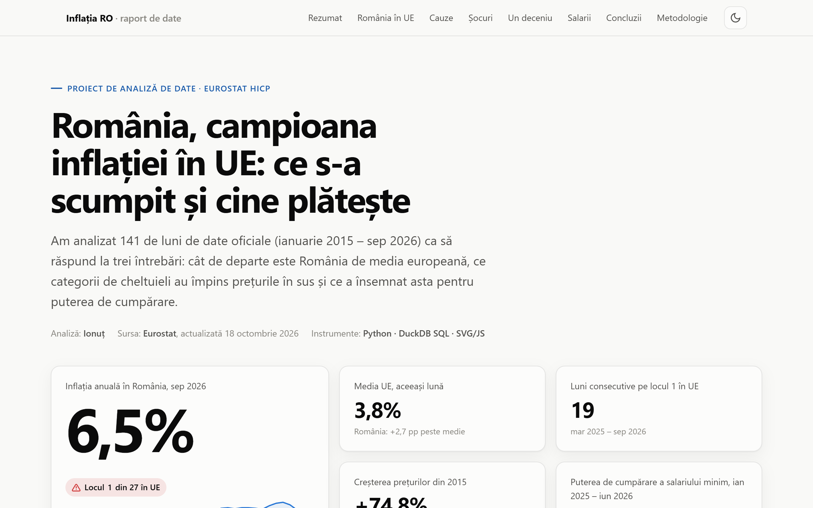
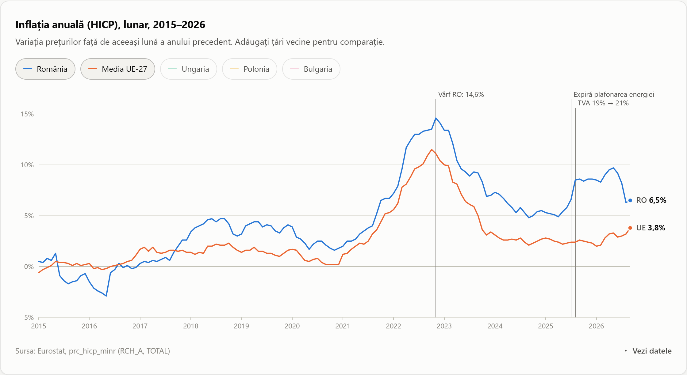
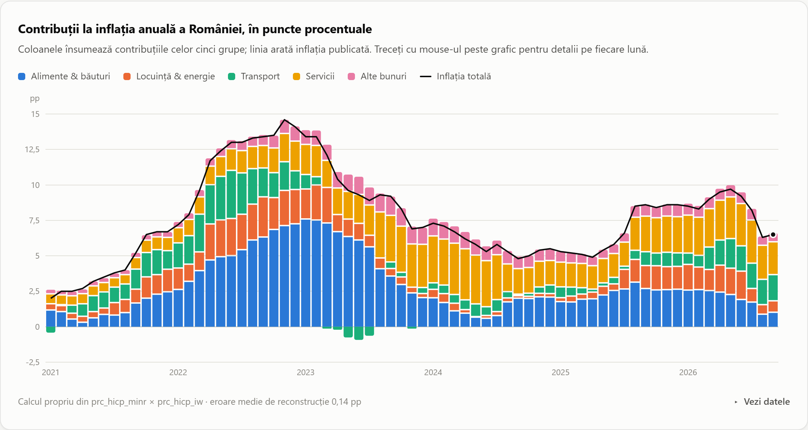
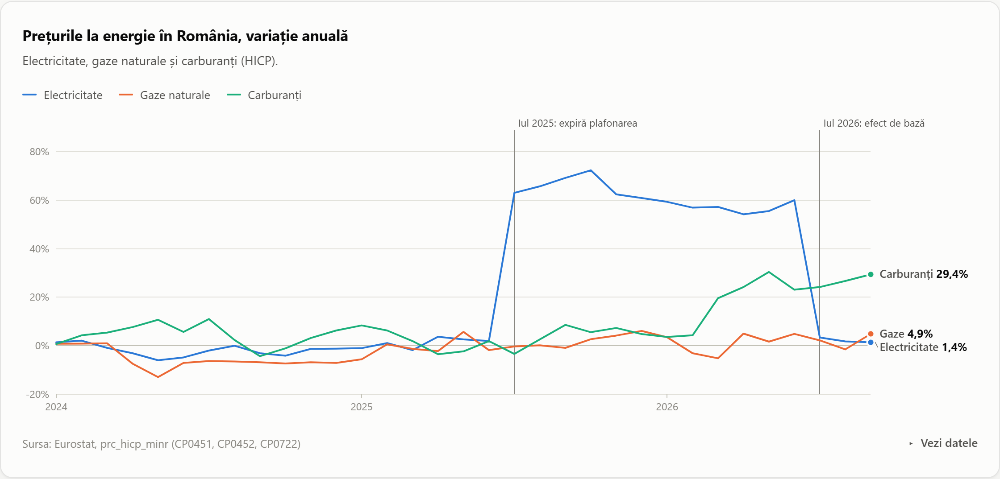
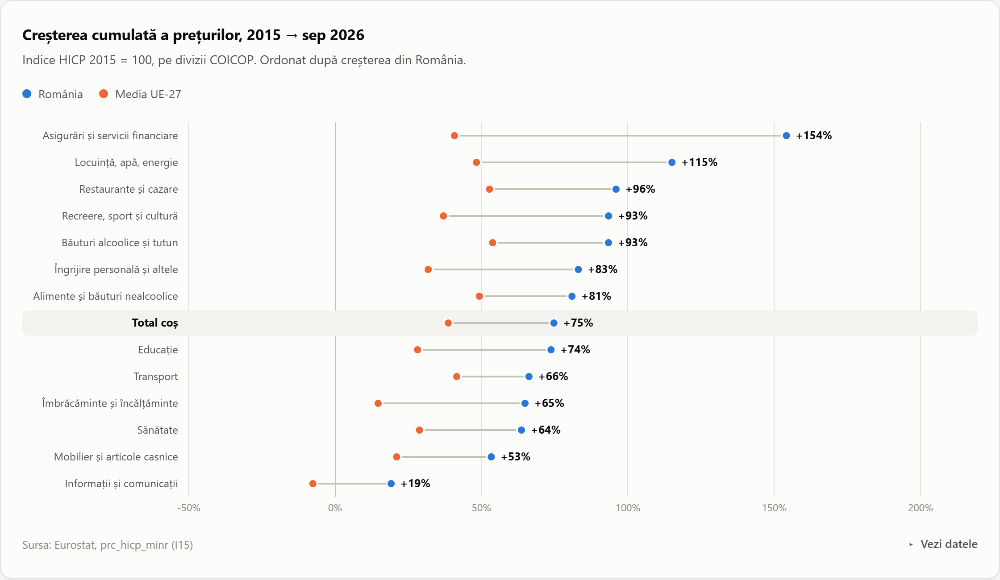

# Romania's inflation vs. the EU, 2015–2026

**What made life more expensive in Romania, why the gap with the EU keeps widening, and what it did to purchasing power.**
An end-to-end analysis built on 141 months of official Eurostat data.

**[▶ Live interactive report](https://romania-inflation-analysis.vercel.app)** · Report language: Romanian · Stack: Python · DuckDB SQL · vanilla JS/SVG



---

## Business questions

1. **Benchmark:** How far is Romania from the EU average, and how often has it ranked #1 for inflation?
2. **Drivers:** Which spending categories drive inflation, and how has the mix changed since 2021?
3. **Policy shocks:** How much of the 2025–2026 spike came from one-off measures (the end of the energy price cap and the VAT increase)?
4. **Impact:** What happened to the purchasing power of the statutory minimum wage?

## Key findings (data to September 2026)

| # | Finding | Evidence |
|---|---------|----------|
| 1 | **Romania has the highest inflation in the EU: 6.5% vs. a 3.8% EU average.** It has ranked #1 for **19 consecutive months**, the longest streak since 2015. | Ranked first in 51 of 141 months; above the EU average in 114 of them. |
| 2 | **The 2025–2026 spike was policy-made.** When the energy price cap expired (Jul 2025), electricity rose **+63% y/y**. With the VAT increase (Aug 2025), headline inflation went from 5.8% to 8.5% in two months. | Both effects left the 12-month comparison in Jul–Aug 2026, and inflation fell from 9.7% to 6.3% without prices actually falling (a base effect). |
| 3 | **Inflation has rotated from food to services and transport.** Services now contribute **2.3 pp** and food only **1.0 pp**. Fuels are up **+29% y/y**. | Contribution analysis: basket weight × annual rate, reconciled to the published rate within **0.14 pp** on average. |
| 4 | **The price level is up 75% since 2015, against 39% in the EU.** Every one of the 13 COICOP divisions rose faster in Romania. | HICP index, 2015 = 100. |
| 5 | **The minimum wage outpaced prices over the decade, but lost 10.4% of its real value** while it was frozen at 4,050 lei for 18 months (Jan 2025–Jun 2026). | Nominal wage index deflated by HICP; I flag the 2018 social-contribution transfer, which inflates gross wages. |

## Visuals

| Benchmark vs. EU | Drivers of inflation |
|---|---|
|  |  |
| **Energy shock & base effect** | **A decade of price growth by category** |
|  |  |

The report is fully interactive. It has crosshair tooltips, keyboard navigation and peer-country toggles, and a data table behind every chart. It supports light and dark themes and works on mobile. The categorical palette was validated for colour-vision deficiency.

## Pipeline

```
Eurostat API (JSON-stat)  →  data/raw/*.csv  →  DuckDB  →  SQL staging → marts  →  QA  →  report/data.json  →  interactive report
      fetch_eurostat.py                     build_dataset.py   sql/01_staging.sql         qa_contributions
                                                               sql/02_marts.sql
```

| Layer | What happens |
|---|---|
| **Extract** ([src/fetch_eurostat.py](src/fetch_eurostat.py)) | Generic JSON-stat 2.0 parser. It pulls 5 datasets (HICP monthly, annual, item weights, minimum wages) and writes tidy CSVs. |
| **Model** ([sql/](sql/)) | Staging views type and clean the raw data. There is one mart per business question. Techniques: `FILTER` pivots, window functions (`rank()`), *gaps-and-islands* for the consecutive #1 streak, weighted contributions, and deflating by a price index. |
| **QA** | `qa_contributions` checks that the sum of the category contributions matches the published headline rate. The mean absolute error is 0.14 pp and the max is 0.60 pp. |
| **Report** ([report/](report/)) | A dependency-free SVG chart kit with line, stacked-diverging, ranked bar, dumbbell and heatmap charts. Every number in the text is bound to the data, not hard-coded. |

## Reproduce

```bash
pip install -r requirements.txt
python src/fetch_eurostat.py     # download latest Eurostat data
python src/build_dataset.py      # build DuckDB models + export report/data.json
python -m http.server -d report  # open http://localhost:8000
```

Re-running the pipeline after a new Eurostat release updates every chart and every number in the report.

## Data sources

All data comes from Eurostat (© European Union, reuse authorised with attribution):

- [`prc_hicp_minr`](https://ec.europa.eu/eurostat/databrowser/view/prc_hicp_minr/default/table): HICP monthly, ECOICOP ver. 2 (annual rate, index 2015 = 100)
- [`prc_hicp_ainr`](https://ec.europa.eu/eurostat/databrowser/view/prc_hicp_ainr/default/table): HICP annual averages
- [`prc_hicp_iw`](https://ec.europa.eu/eurostat/databrowser/view/prc_hicp_iw/default/table): HICP item weights
- [`earn_mw_cur`](https://ec.europa.eu/eurostat/databrowser/view/earn_mw_cur/default/table): monthly minimum wages

## Limitations

- HICP is the EU-harmonised index. It differs slightly from the national CPI published by INS.
- The contributions are an approximation, because HICP is chain-linked annually. The QA view above quantifies the error.
- The minimum wage is **gross**. The 2018 transfer of social contributions to employees inflates the gross series, which is why the report also shows real growth from Jan 2018 (+34%).
- The analysis is descriptive and contains no forecasts.

## Repository structure

```
├── src/
│   ├── fetch_eurostat.py      # Extract: Eurostat API → data/raw
│   └── build_dataset.py       # Load + run SQL + export
├── sql/
│   ├── 01_staging.sql         # typed/cleaned views
│   └── 02_marts.sql           # one model per business question + QA
├── data/
│   ├── raw/                   # API extracts (CSV)
│   └── processed/             # analysis-ready tables (CSV)
├── report/                    # interactive report (deployed as static site)
│   ├── index.html
│   ├── data.json
│   └── assets/                # charts.js, app.js, style.css
└── docs/                      # screenshots
```

---

*Author: **Ionut Daniel Pop** · GitHub [@Ionutpop90](https://github.com/Ionutpop90)*
